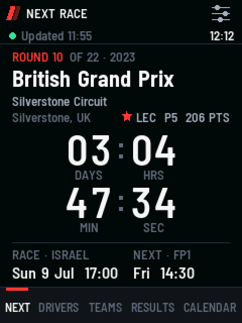

# Gridline F1

תצוגת פורמולה 1 שולחנית ועצמאית ללוח **ESP32-2432S028** (מסך מגע 2.8", ‏320×240 לרוחב).
הקושחה מתחברת ל‑Wi‑Fi, מושכת נתונים אמיתיים מ‑[Jolpica‑F1 API](https://github.com/jolpica/jolpica-f1) ב‑HTTPS מאומת, ועובדת בלי מחשב אחרי ההתקנה.

**מסכים:** המרוץ הבא (ספירה לאחור, שעון ישראל), טבלת נהגים, טבלת קבוצות, תוצאות המרוץ האחרון, לוח העונה, הגדרות ואבחון.

<p>
  
  
  
</p>

## הורדה והתקנה

החבילה המוכנה (קושחה, תוכנת התקנה ל‑Windows, מדריך ומודלים להדפסה) נמצאת ב‑[Releases](../../releases/latest).
מורידים את קובץ ה‑ZIP מהגרסה האחרונה, מחלצים, ופותחים את `software/START-HERE.html`.

| מסמך | תוכן |
|---|---|
| [docs/START-HERE.md](docs/START-HERE.md) | התחלה מהירה |
| [docs/HEBREW-GUIDE.md](docs/HEBREW-GUIDE.md) | מדריך התקנה ושימוש מלא + פתרון בעיות |
| [docs/ARCHITECTURE.md](docs/ARCHITECTURE.md) | ארכיטקטורה, פינים, מחיצות, אבטחה, מקור נתונים |
| [docs/VALIDATION.md](docs/VALIDATION.md) | דוח בדיקות כן: מה נבדק, ומה עוד דורש את הלוח |
| [docs/CA-CERTIFICATES.md](docs/CA-CERTIFICATES.md) | עדכון תעודות TLS בעתיד |
| [docs/THIRD-PARTY-NOTICES.md](docs/THIRD-PARTY-NOTICES.md) | רישיונות |

## המעמד המודפס

| קובץ | מה הוא |
|---|---|
| [hardware/F1_screen.3mf](hardware/F1_screen.3mf) | פרויקט Bambu Studio עם שני החלקים על המשטח, מוכן לפריסה |
| [hardware/Gridline_Stand_Portrait_Body.stl](hardware/Gridline_Stand_Portrait_Body.stl) | גוף המעמד (לאורך), כ‑66×148×62 מ"מ |
| [hardware/Gridline_Lid.stl](hardware/Gridline_Lid.stl) | המכסה האחורי עם חריצי אוורור, כ‑92×56×9 מ"מ |

הגדרות הדפסה: Bambu Lab X2D עם פיה 0.4 מ"מ, ‏PETG, שכבה 0.2 מ"מ, מילוי 15%, בלי תמיכות.

## מבנה
```
src/                 קושחה (ממשק, רשת, הגדרת Wi-Fi, תצוגה, מגע, אחסון)
lib/gridline_core/   לוגיקה טהורה ונבדקת: זמן, HTTP, JSON, תזמון, מטמון, כיול
test/host/           בדיקות יחידה למחשב        test/sim/  סימולטור ממשק
test/installer/      בדיקות תוכנת ההתקנה      test/emulator/  בניית בדיקה ל-QEMU
installer/           תוכנת ההתקנה ל-Windows (Python + קבצי bat + wheels)
tools/               בנייה, בדיקות, פונטים, תעודות, חבילת שחרור
hardware/            מודלים להדפסת המעמד והמכסה
```

## בנייה
```
pip install platformio==6.1.18
pio run -e st7789                  # יעד ראשי
pio run -e ili9341                 # חלופה
./tools/run_host_tests.sh          # בדיקות יחידה
./tools/run_simulator.sh           # צילומי מסך מהסימולטור
python3 tools/make_release.py      # חבילת Windows מלאה
```

עיצוב: Roei Rosenberg, Industrial Designer.

פרויקט אישי לא רשמי. Formula 1 ו‑F1 הם סימנים מסחריים של Formula One Licensing B.V.
