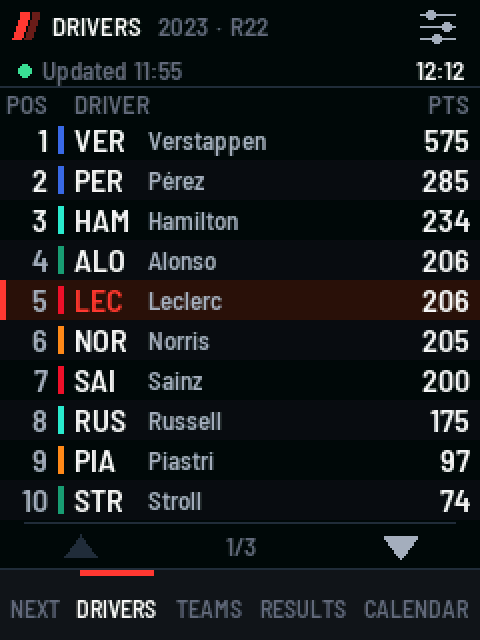
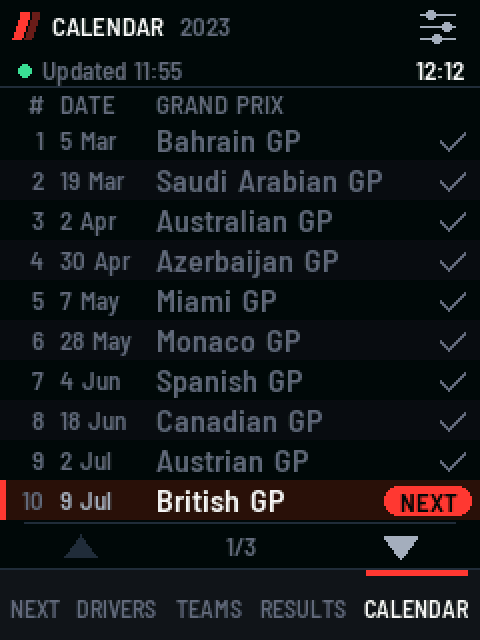

# Gridline F1

A standalone desktop Formula 1 display for the **ESP32-2432S028** board (2.8" touch screen, 320×240 landscape or 240×320 portrait).
The firmware connects to Wi‑Fi, pulls live data from the [Jolpica‑F1 API](https://github.com/jolpica/jolpica-f1) over verified HTTPS, and runs on its own without a computer once installed.

**Screens:** next race (countdown in Israel time), driver standings, constructor standings, last race results, season calendar, settings and diagnostics.

<p>
  
  
  
</p>

More screenshots: [preview/index.html](preview/index.html) (open the file locally, or browse [preview/screens](preview/screens)).

## Download and install

The ready-to-use package (firmware, Windows installer, guide and 3D models) is on the [Releases](../../releases/latest) page.
Download the ZIP from the latest release, extract it, and open `software/START-HERE.html`.

| Document | Contents |
|---|---|
| [docs/START-HERE.md](docs/START-HERE.md) | Quick start |
| [docs/GUIDE.md](docs/GUIDE.md) | Full install and user guide, with troubleshooting |
| [docs/ARCHITECTURE.md](docs/ARCHITECTURE.md) | Architecture, pinout, partitions, security, data source |
| [docs/VALIDATION.md](docs/VALIDATION.md) | Honest test report: what was tested, and what still needs the real board |
| [docs/CA-CERTIFICATES.md](docs/CA-CERTIFICATES.md) | Updating the TLS certificates in the future |
| [docs/THIRD-PARTY-NOTICES.md](docs/THIRD-PARTY-NOTICES.md) | Licenses |

## 3D-printed stand

| File | What it is |
|---|---|
| [hardware/F1_screen.3mf](hardware/F1_screen.3mf) | Bambu Studio project with both parts on the plate, ready to slice |
| [hardware/Gridline_Stand_Portrait_Body.stl](hardware/Gridline_Stand_Portrait_Body.stl) | Stand body (portrait), about 66 × 148 × 62 mm |
| [hardware/Gridline_Lid.stl](hardware/Gridline_Lid.stl) | Back lid with vent slots, about 92 × 56 × 9 mm |

Print settings: Bambu Lab X2D with a 0.4 mm nozzle, PETG, 0.2 mm layers, 15% infill, no supports.

## Project layout
```
src/                 firmware (UI, networking, Wi-Fi setup, display, touch, storage)
lib/gridline_core/   pure, tested logic: time, HTTP, JSON, scheduling, cache, calibration
test/host/           unit tests for the PC          test/sim/       UI simulator
test/installer/      installer tests                test/emulator/  QEMU test build
installer/           Windows installer (Python + .bat files + wheels)
tools/               build, tests, fonts, certificates, release package
hardware/            3D models for the stand and lid
```

## Building
```
pip install platformio==6.1.18
pio run -e st7789                  # main target
pio run -e ili9341                 # alternative display
./tools/run_host_tests.sh          # unit tests
./tools/run_simulator.sh           # screenshots from the simulator
python3 tools/make_release.py      # full Windows package
```

Design: Roei Rosenberg, Industrial Designer.

Unofficial personal project. Formula 1 and F1 are trademarks of Formula One Licensing B.V.
